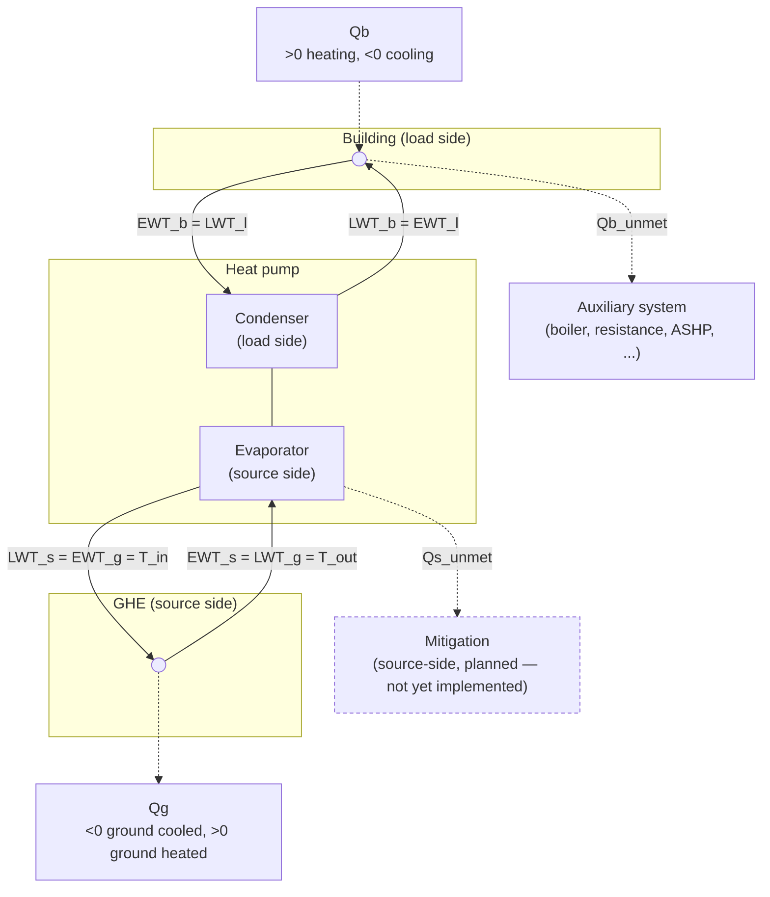

# System diagram

*Draft — not yet linked from `make.jl` or the README. Companion illustration for the README's
["Conventions"](https://github.com/GHE-jl/GroundSourceHeatPumpDesign.jl#conventions) section: same
nomenclature, shown on the three physical pieces (building, heat pump, GHE) instead of just
described in prose.*

## Reading the diagram

- **Load loop** (building ↔ condenser): `EWT_b = LWT_l` is the fluid leaving the building and
  entering the condenser; `LWT_b = EWT_l` is the fluid leaving the condenser and returning to the
  building. `b` = building, `l` = load (condenser).
- **Source loop** (evaporator ↔ GHE): `LWT_s = EWT_g = T_in` is the fluid leaving the evaporator and
  entering the ground field; `EWT_s = LWT_g = T_out` is the fluid leaving the field and returning to
  the evaporator. `s` = source (evaporator), `g` = ground.
- **Loads**: `Qb` is the building load carried by the load loop; `Qg` is the ground load carried by
  the source loop, related to `Qb` by [`ground_load`](@ref) (fixed COP, capacity-capped, or
  performance-curve-based, depending on the method). The heat pump itself is where the sign flips
  and the COP/CAP conversion happens — it is not a passive pass-through between the two loops.
- The heat pump's operating limits are checked against `EWT_s` (`T_out`), i.e. the `Tsrc` grid of
  [`heat_pump_performance`](@ref).
- **Unmet loads**: `Qb_unmet` is building-side demand the installed heat pumps can't cover, handed
  off to an **auxiliary** system (boiler, electric resistance, cooling tower, ASHP, ...). `Qs_unmet`
  is the source-side counterpart from **mitigation** (a correction to keep the source fluid within
  the heat pump's operating envelope) — shown dashed since it isn't implemented yet (see the
  README's "Simulation cases", case 3).

## Open questions for the next iteration

- [ ] Worth adding flow direction arrows for a cooling-mode variant, or is one heating-mode diagram
      enough since only the sign of `Qb`/`Qg` changes?
- [ ] Where should this end up long-term — a new `docs/src` page wired into `make.jl`, or inlined
      into the README next to "Conventions"? **On standby for now.**
